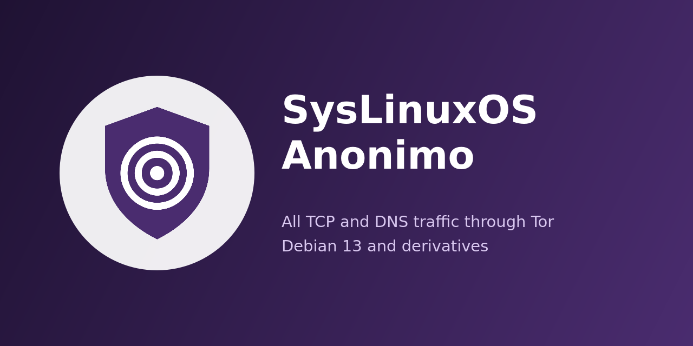
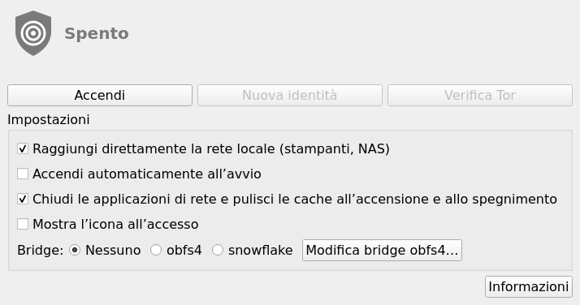
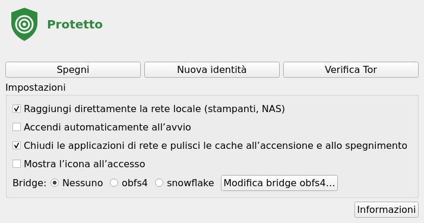
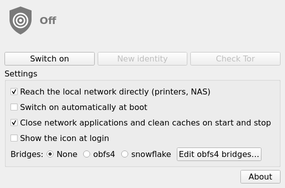
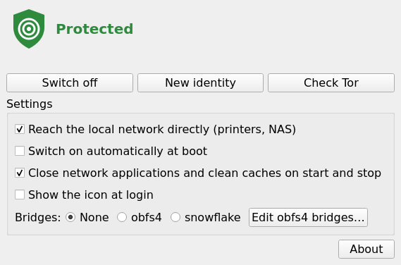

# SysLinuxOS Anonimo

<p align="center"></p>

[Italiano](#italiano) · [English](#english) · [Changelog](CHANGELOG.md) · [Releases](https://github.com/fconidi/syslinuxos-anonimo/releases)

## Italiano

Guida completa: [installazione e utilizzo](https://francoconidi.it/syslinuxos-anonimo-guida-installazione-utilizzo/).

SysLinuxOS Anonimo fa passare **il traffico TCP e DNS del computer attraverso Tor** con un clic.
Quando è acceso, ogni connessione TCP e ogni richiesta DNS passano da Tor. Il resto del traffico
che esce dal computer viene bloccato, tranne il traffico verso la rete locale (quando l'opzione
*rete locale diretta* è attiva, come di default) e il DHCP. Quando è spento, la rete torna esattamente com'era.

Funziona in modo diverso da AnonSurf, a cui si ispira:

- aggiunge una **tabella nftables tutta sua** (`inet anonimo`) e la toglie allo spegnimento:
  le regole di ufw, Docker e libvirt non vengono mai toccate;
- usa una **istanza di Tor separata** (`syslinuxos-anonimo-tor.service`, utente `_anonimo`):
  `/etc/tor/torrc` resta com'è;
- **non modifica** `/etc/resolv.conf` né NetworkManager: il DNS viene dirottato verso Tor dal firewall;
- è **a prova di guasto**: se Tor si blocca, il traffico verso Internet resta fermo invece di uscire in chiaro;
- se `nftables.service` viene avviato, ricaricato o fermato mentre anonimo è acceso (il file
  `/etc/nftables.conf` di Debian svuota tutte le regole), la tabella di anonimo viene ricaricata subito.
  Dopo aver caricato a mano le proprie regole nftables (`nft -f …`), eseguire di nuovo `anonimo start`.

 

### Installazione

Per Debian 13 (trixie) e derivate; testato su SysLinuxOS 13 (MATE, GNOME e GNOME Classic). Il pacchetto è
`all` (Python 3 + PyQt5) e non è stato provato su Debian "liscia" né su Ubuntu.
Scarica il `.deb` dalle [Releases](https://github.com/fconidi/syslinuxos-anonimo/releases) e installalo con apt, così arrivano anche le dipendenze (`tor`, `obfs4proxy`, `nftables`, `python3-pyqt5`, `pkexec`):

```bash
sudo apt install ./syslinuxos-anonimo_2026.10.1_all.deb
```

Consigliati (installati da apt se le Recommends sono attive): `snowflake-client`, `bleachbit` e un
agente polkit nella sessione grafica. Su **GNOME** l'icona nell'area di notifica richiede obbligatoriamente
l'estensione AppIndicator: `sudo apt install gnome-shell-extension-appindicator`, poi attivare
`ubuntu-appindicators@ubuntu.com` (`gnome-extensions enable …`) e rifare il login. Senza l'estensione
anonimo funziona lo stesso, solo con la finestra.

Rimozione: `sudo apt remove syslinuxos-anonimo` (`purge` riattiva anche `tor.service`, vedi sotto).
Cosa è stato verificato: [VALIDATION.md](VALIDATION.md). Non usare su un computer importante
prima di aver provato `anonimo stop` e il recupero descritto più sotto.

### Uso

- Dal menu **SysLinuxOS Tools → SysLinuxOS Anonimo**: finestra e icona nell'area di notifica
  (grigia = spento, gialla = connessione in corso, verde = protetto, rossa = errore).
- Da terminale: `anonimo start`, `anonimo stop`, `anonimo status --check`, `anonimo identity`.
- Impostazioni: rete locale diretta (stampanti, NAS), bridge obfs4 o snowflake per le reti
  che bloccano Tor, accensione automatica all'avvio, chiusura dei programmi di rete con pulizia
  delle cache (BleachBit).

### Cosa non funziona mentre è acceso

- UDP verso Internet (giochi online, videochiamate), IPv6 verso Internet, scoperta automatica
  dei dispositivi (`.local`), container Docker e macchine virtuali.
- I servizi di questo computer (SSH, web server, condivisione file) non possono rispondere agli
  host fuori dalla rete locale, né agli host della rete locale se l'opzione *rete locale diretta* è spenta.
- Le connessioni verso Internet già aperte quando si accende vengono interrotte.
- Con l'opzione *rete locale diretta* attiva, i dispositivi della rete locale si raggiungono per indirizzo IP.
  Per anonimo la rete locale è: `10.0.0.0/8`, `172.16.0.0/12`, `192.168.0.0/16`, `169.254.0.0/16`
  (link-local), `fe80::/10`, `fc00::/7`.

### Da sapere

- Con l'opzione *rete locale diretta* attiva, tutto ciò che viene inviato a un host della rete locale
  esce fuori da Tor: un proxy HTTP o SOCKS della rete locale (anche quello impostato con le variabili
  `http_proxy` e `https_proxy`), il DNS su TLS o su HTTPS verso il router o un Pi-hole, un gateway della
  rete locale. Se tutto deve passare da Tor, spegnere l'opzione.
- Con i bridge snowflake, il programma del bridge invia da sé le proprie richieste DNS e il traffico
  STUN/WebRTC direttamente, fuori da Tor: chi osserva la rete può capire che si usa snowflake (come con
  Tor Browser), non che cosa si visita.
- Firefox blocca i nomi `.onion` per impostazione predefinita (`network.dns.blockDotOnion`): per aprire
  i siti `.onion` usare Tor Browser, oppure impostare quella preferenza a `false` in `about:config`.

### Se la rete resta bloccata

Per tornare alla rete normale:

```bash
anonimo stop --no-close-apps
anonimo settings --boot off
```

Se anonimo non risponde, questo comando toglie la tabella solo per la sessione attuale:

```bash
sudo nft delete table inet anonimo
```

Con l'accensione automatica all'avvio attiva, la tabella viene caricata di nuovo a ogni avvio,
finché non si esegue `anonimo settings --boot off`. Con l'accensione automatica all'avvio spenta,
un riavvio riporta sempre la rete normale.

### Tor di Debian

Alla prima installazione, se `/etc/tor/torrc` non è stato modificato, l'istanza Tor predefinita di Debian
(`tor.service`) viene disattivata: anonimo non la usa. `apt remove syslinuxos-anonimo` lascia
`tor.service` disattivato; solo `apt purge syslinuxos-anonimo` lo riattiva.

## English

Full walkthrough: [installation and usage guide](https://syslinuxos.com/syslinuxos-anonimo-installation-usage-guide/).

SysLinuxOS Anonimo routes **the TCP and DNS traffic of the computer through Tor** with one click.
When it is on, every TCP connection and every DNS query goes through Tor. The rest of the traffic
leaving the computer is blocked, except traffic to the local network (when the direct local network
option is on, as by default) and DHCP. When it is off, the network is exactly as before.

It works differently from AnonSurf, which inspired it:

- it adds **its own nftables table** (`inet anonimo`) and removes it when switched off:
  ufw, Docker and libvirt rules are never touched;
- it uses a **separate Tor instance** (`syslinuxos-anonimo-tor.service`, user `_anonimo`):
  `/etc/tor/torrc` is left alone;
- it **does not edit** `/etc/resolv.conf` or NetworkManager: DNS is redirected to Tor by the firewall;
- it **fails closed**: if Tor stops, traffic to the Internet stays blocked instead of leaving in the clear;
- if `nftables.service` is started, reloaded or stopped while anonimo is on (Debian's
  `/etc/nftables.conf` flushes all rules), anonimo's table is loaded again at once.
  After loading your own nftables rules by hand (`nft -f …`), run `anonimo start` again.

 

### Installation

For Debian 13 (trixie) and derivatives; tested on SysLinuxOS 13 (MATE, GNOME and GNOME Classic). The package is
`all` (Python 3 + PyQt5) and has not been tried on plain Debian or on Ubuntu.
Download the `.deb` from [Releases](https://github.com/fconidi/syslinuxos-anonimo/releases) and install it with apt, so the dependencies come along too (`tor`, `obfs4proxy`, `nftables`, `python3-pyqt5`, `pkexec`):

```bash
sudo apt install ./syslinuxos-anonimo_2026.10.1_all.deb
```

Recommended (installed by apt when Recommends are enabled): `snowflake-client`, `bleachbit` and a
polkit agent in the graphical session. On **GNOME** the notification-area icon requires the
AppIndicator extension: `sudo apt install gnome-shell-extension-appindicator`, then enable
`ubuntu-appindicators@ubuntu.com` (`gnome-extensions enable …`) and log in again. Without the extension
anonimo still works, with the window only.

Removal: `sudo apt remove syslinuxos-anonimo` (`purge` also enables `tor.service` again, see below).
What was verified: [VALIDATION.md](VALIDATION.md). Do not use it on an important computer before
you have tried `anonimo stop` and the recovery described below.

### Usage

- Menu **SysLinuxOS Tools → SysLinuxOS Anonimo**: window and notification-area icon
  (grey = off, yellow = connecting, green = protected, red = error).
- Terminal: `anonimo start`, `anonimo stop`, `anonimo status --check`, `anonimo identity`.
- Settings: direct local network (printers, NAS), obfs4 or snowflake bridges for networks
  that block Tor, start at boot, closing network applications and cleaning caches (BleachBit).

### What does not work while it is on

- UDP to the Internet (online games, video calls), IPv6 to the Internet, device discovery (`.local`),
  Docker containers and virtual machines.
- Services of this computer (SSH, web server, file sharing) cannot answer hosts outside the local
  network, nor local hosts when the direct local network option is off.
- Connections to the Internet already open when it switches on are cut.
- With the direct local network option on, local devices are reachable by IP address.
  For anonimo the local network is: `10.0.0.0/8`, `172.16.0.0/12`, `192.168.0.0/16`, `169.254.0.0/16`
  (link-local), `fe80::/10`, `fc00::/7`.

### Good to know

- With the direct local network option on, anything sent to a host of the local network leaves
  outside Tor: a local HTTP or SOCKS proxy (also one set with the `http_proxy` and `https_proxy`
  variables), DNS over TLS or over HTTPS to the router or a Pi-hole, a gateway on the local network.
  If everything must go through Tor, switch the option off.
- With snowflake bridges, the bridge program sends its own DNS queries and its STUN/WebRTC traffic
  directly, outside Tor: someone watching the network can tell that snowflake is in use (as with
  Tor Browser), not what is visited.
- Firefox blocks `.onion` names by default (`network.dns.blockDotOnion`): to open `.onion` sites use
  Tor Browser, or set that preference to `false` in `about:config`.

### If the network stays blocked

To get the normal network back, run:

```bash
anonimo stop --no-close-apps
anonimo settings --boot off
```

If anonimo does not respond, this command removes the table for the current session only:

```bash
sudo nft delete table inet anonimo
```

With "start at boot" on, the table is loaded again at every boot, until
`anonimo settings --boot off` is run. With "start at boot" off, a reboot always brings the
normal network back.

### Debian's Tor

On the first installation, if `/etc/tor/torrc` was not modified, Debian's default Tor instance
(`tor.service`) is disabled: anonimo does not use it. `apt remove syslinuxos-anonimo` leaves
`tor.service` disabled; only `apt purge syslinuxos-anonimo` enables it again.

## Credits and licence

Copyright 2026 Franco Conidi. GPL-3.0-or-later. Inspired by AnonSurf of the Parrot Security
team; no AnonSurf code is used. Tor is a trademark of The Tor Project, Inc.
